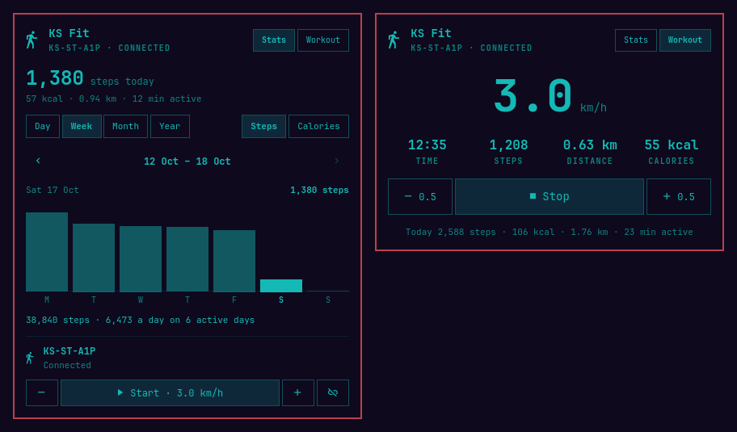

# KS Fit for Omarchy

Control a KingSmith WalkingPad from the [Omarchy](https://omarchy.org) bar and
chart your steps and calories: start and stop the belt, change its speed, follow
the walk in the bar, and look back over days, weeks, months and years.



A small Rust helper owns the Bluetooth link to the pad and keeps the walks in a
local SQLite database. The plugin's QML shows what the helper reports and sends
it your commands.

## Features

- **Bar:** a walking figure, lit while connected; during a walk the time and
  steps of the session (`12:34 · 1,023`).
- **Panel:** today's steps, calories, distance and active time; the last walk; a
  chart of steps or calories by day, week, month or year, with totals and the
  average per active day; scanning for and connecting to a pad; Start with a
  target speed.
- **Workout view** while the belt moves: speed, time, steps, distance and
  calories, with Stop as the largest control and ±0.5 km/h beside it.
- **Demo mode** runs against a simulated pad with made-up history, for trying
  the plugin without a treadmill.

## Supported hardware

WalkingPads that speak KingSmith's older `FE00` Bluetooth service, which other
open-source controllers drive on the A1, A1 Pro (`KS-ST-A1P`), C1, C2, R1 Pro
and R2 Pro. Pads that use FTMS or KingSmith's newer text protocol are recognised
and refused for now; the panel says which one it found.

The pad takes one Bluetooth connection at a time: close the KS Fit phone app
before connecting, and turn off any other WalkingPad plugin so they don't take
turns polling the pad.

## Requirements

- Omarchy 4 with a Bluetooth adapter (BlueZ ships with Omarchy)
- Rust, once, to build the helper: Omarchy menu → Install → Development → Rust

Nothing needs root, and no system service is set up.

## Installation

```sh
omarchy plugin add https://github.com/langri-sha/omarchy-ks-fit.git --enable
```

### The helper

The plugin can't talk to the pad until its helper is built. Open the KS Fit
panel from the bar and choose **Build helper**: a terminal compiles the helper
from the plugin's own Rust source with cargo, which takes a couple of minutes.
Nothing leaves the machine except crate downloads. The binary goes to
`~/.local/share/omarchy-ks-fit/helpers/<version>/ks-fit`, and the panel picks it
up as soon as the build finishes. After an update that changes the version, the
panel asks for a rebuild.

Because of this build step, the plugin marketplace may list KS Fit as "Manual
setup".

## Usage

Turn the pad on, open the panel and choose **Scan for pads**, then pick your
pad. KS Fit remembers it and reconnects whenever the panel opens or the pad
comes back in range.

- **Bar:** left click opens the panel. Nothing else on the bar drives the belt.
- **Panel:** **Start** walks off at the target speed shown on the button; set it
  first with − and +. Stop, and ±0.5 km/h, sit in the workout view while the
  belt moves.
- **Keyboard:** the arrow keys or `hjkl` move between controls and `Enter` or
  `Space` presses the one under the cursor. Start only answers a cursor you
  moved there with the arrow keys, never one a resting mouse pointer left on it.
  `Backspace` or `0` stops the belt from anywhere in the panel. `d` `w` `m` `y`
  pick the period, `s` and `c` steps or calories, `,` and `.` go back and forth,
  and `r` scans again. `Tab` moves to the next bar panel and `Esc` closes.

## Keybindings

None are installed for you. To add some, put these in
`~/.config/hypr/bindings.lua`:

```lua
o.bind("SUPER + ALT + W", "KS Fit", "omarchy-shell shell toggle io.github.langri-sha.ks-fit")
o.bind("SUPER + SHIFT + ALT + W", "KS Fit stop", "omarchy-shell io.github.langri-sha.ks-fit stop")
```

The `io.github.langri-sha.ks-fit` target also answers `start`, `toggle`,
`faster`, `slower`, `speed <km/h>`, `status` and `retryHelper`. `start`, `stop`
and `toggle` print `ok`, or what stands in the way as far as the panel knows
(`not-connected`, `busy`, `helper-missing`, …); a running helper still gets the
command and has the last word.

## Settings

Settings live on the bar widget's entry in `~/.config/omarchy/shell.json`:

```sh
omarchy bar set io.github.langri-sha.ks-fit weightKg 82 --json
```

| Key        | Default | Meaning                                                    |
| ---------- | ------- | ---------------------------------------------------------- |
| `weightKg` | `70`    | Body weight the calories are estimated for, 20–300         |
| `demo`     | `false` | Drive a simulated pad with its own made-up history instead |

The − and + next to "estimated for 70 kg" in the calories chart change the
weight too. Switching demo mode waits until the belt stands still.

## Data and privacy

- `~/.local/share/omarchy-ks-fit/ks-fit.db`: your walks, per minute, and the
  remembered pad (`demo.db` beside it holds demo mode's history)
- `~/.local/share/omarchy-ks-fit/helpers/`: the built helper
- `~/.cache/omarchy-ks-fit/`: the helper's build cache

Nothing is sent anywhere. The database is plain SQLite, readable with `sqlite3`.

## Safety

You're standing on the thing, so KS Fit refuses to surprise you:

- It never starts the belt on its own: not on connect or reconnect, not after a
  restart, not from a hover, a scroll or a key on a freshly opened panel. Start
  takes a click, `Enter` or `Space` on a Start you moved to with the arrow keys,
  or the `start`/`toggle` command. The panel's Start stays off for 3 s after the
  belt comes to rest, so a second click meant for Stop doesn't start it again.
- Stop is always available while the pad is connected: in the panel, with
  `Backspace` or `0`, and over IPC. If the pad doesn't confirm a stop, the panel
  and a notification tell you to use the remote.
- It never sends the belt a command when it shuts down, crashes or loses the
  link: an unexpected stop is as dangerous as an unexpected start. The remote
  keeps working throughout.
- Speed never fights the remote: when you change speed on the remote, KS Fit
  adopts it as the new target.
- While the belt moves, the screen stays awake, so the panel's Stop isn't hidden
  behind a lock screen. After a lost link it stays awake until the pad is seen
  standing still again.

## Update

```sh
omarchy plugin update io.github.langri-sha.ks-fit
```

KS Fit keeps its helper running while plugins reload, so a walk isn't cut short.
After an update the panel asks you to restart the shell to load the new version;
its **Restart shell** button waits until the belt has stopped. If the version
changed, it then asks for a rebuild of the helper.

## Removal

```sh
omarchy plugin remove io.github.langri-sha.ks-fit
rm -rf ~/.cache/omarchy-ks-fit ~/.local/share/omarchy-ks-fit/helpers
```

That keeps your walk history. To delete it as well, remove the whole
`~/.local/share/omarchy-ks-fit`.

## Troubleshooting

- **Bluetooth is off:** the panel's **Turn on** runs
  `omarchy-bluetooth-power on`.
- **"KS-ST-A1P isn't nearby":** check the pad is switched on, and close the KS
  Fit phone app, which holds the connection while it is open.
- **The helper stopped working:** the panel shows its last message; **Retry**
  starts it again. Its log lines go to the shell's log, prefixed `ks-fit:`:
  `qs log -p "$OMARCHY_PATH/shell" | grep ks-fit`.

## Development

The repository is the plugin: `manifest.json` and the QML in `shell/` load as
they are, and the helper is the `daemon/` crate.
[docs/contributing.md](docs/contributing.md) covers how it fits together and how
to try a change in the shell.

```sh
pnpm i
pnpm test             # helper and Model.js tests
pnpm qmllint          # lint the QML against the installed shell
pnpm plugin:render    # render the plugin offscreen against a mock helper
pnpm plugin:validate  # validate it as `omarchy plugin add` would
bin/ks-fit-build      # build the helper into ~/.local/share/omarchy-ks-fit
```

The tooling is generated by [projen](https://projen.io) from `.projenrc.ts` with
[`@langri-sha/projen-project`](https://github.com/langri-sha/projen); run
`pnpm exec projen` after changing it.

## License

MIT. The helper's dependencies are listed in `Cargo.lock`, each under its own
license.
